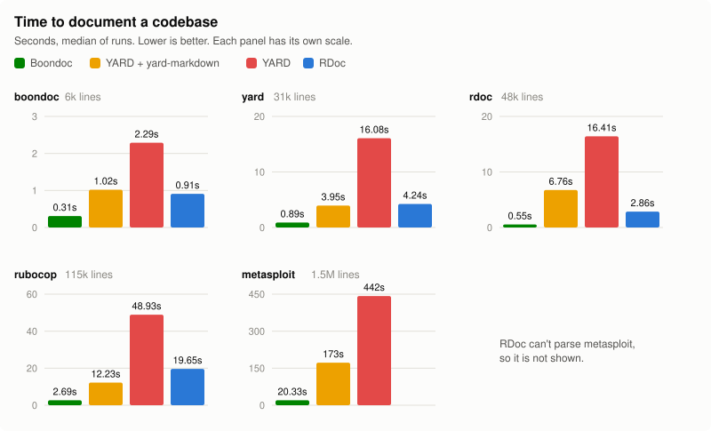

# Boondoc

Markdown-only API documentation for Ruby.

Boondoc reads the YARD-style comments you already write and produces plain
GitHub-flavored markdown: one file per class or module, an index, and working
relative links between them. There is no HTML and no site to deploy or host. The
output renders directly in a repository's `docs/` folder.

Because everything is markdown from start to finish, your README, changelog
and guides are stitched in as they are, and `{Foo#bar}` references inside them
become real links.

## Installation

```sh
bundle add boondoc --group development
```

or

```sh
gem install boondoc
```

Boondoc needs Ruby 3.3 or newer.

## Usage

```sh
boondoc                                  # document lib/**/*.rb into docs/
boondoc 'app/**/*.rb' lib -o docs/api    # choose the sources and the output
boondoc --files CHANGELOG.md 'guides/*.md'
```

| Option | Meaning |
| --- | --- |
| `-o`, `--output DIR` | Output directory. Default `docs`. It must be inside the project, see `--allow-outside-output`. |
| `--index NAME` | Name of the index page. Default `README.md`, which GitHub shows when browsing the folder. |
| `--readme FILE` | File used as the top of the index page. Default `README.md` if present. |
| `--skip-readme` | Leave the README out of the index page. |
| `--files a.md b/*.md` | Extra files to stitch in. |
| `--assets FILES` | Files, directories, or globs to copy into the output, such as images. `FROM:DIR` copies into `DIR` instead. See [Assets](#assets). |
| `--copy-linked-assets` | Also copy the files that pages embed, such as images in the README and in doc comments. |
| `--exclude GLOBS` | Ruby files to leave out. |
| `--title TITLE` | Index title when there is no README. |
| `--private`, `--protected` | Include those methods (and `@private` objects). |
| `--yard-macros` | Expand `@!macro`, `@!method`, and `@!attribute` with the yard gem. See below. |
| `--no-yardopts` | Do not read `.yardopts`. See [Reading `.yardopts`](#reading-yardopts). |
| `--strict` | Exit non-zero on any warning, such as a link that does not resolve. |
| `--force` | Overwrite files in the output directory that Boondoc did not write. |
| `--allow-outside-output` | Let the output directory be outside the project, for docs kept outside the repository. This is a security risk if you do not trust the project, see [Where Boondoc reads and writes](#where-boondoc-reads-and-writes). Command line and Rake options only, never `.boondoc.yml`. |
| `-c`, `--config FILE` | Config file. Default `.boondoc.yml`. |
| `-q`, `--quiet` | Only print warnings and errors. |

The same settings can live in `.boondoc.yml`:

```yaml
sources:
  - lib/**/*.rb
output: docs
files:
  - CHANGELOG.md
  - guides/*.md
strict: true
```

### Rake

```ruby
require 'boondoc/rake_task'

Boondoc::RakeTask.new(:docs) do |t|
  t.options = { files: ['CHANGELOG.md'], strict: true }
end
```

## What gets written

```
docs/README.md             your README, then an index of the API and the stitched files
docs/Foo.md                one page per class or module
docs/Foo/Bar.md            nested namespaces mirror the directory structure
docs/top-level.md          top-level methods and constants, if there are any
docs/files/CHANGELOG.md    stitched files
docs/.boondoc-manifest     the list of files boondoc wrote
```

Classes and modules whose names differ only by case, such as `Guard::CLI` and
`Guard::Cli`, would share a file on case-insensitive filesystems. Boondoc adds
the kind to both names (`Guard/CLI.class.md` and `Guard/Cli.module.md`, and
`Guard/Cli.module/` for the children of the module), so the output is the same
on every platform. Two of the same kind get a number as well (`Cli.class-2.md`).
Names that don't collide are left alone.

On every run Boondoc removes pages it wrote earlier that no longer correspond
to anything, and it refuses to overwrite a file it did not write unless you
pass `--force`. Files you add to the output directory by hand are left alone.

### Where Boondoc reads and writes

Boondoc limits what a project can make it read or write, because the project
(its comments, symlinks, and `.boondoc.yml`) may come from someone else, such as
a pull request that CI builds docs for.

- The output directory must be inside the project and must not be, or sit
  below, a symlink. `.boondoc.yml` cannot move it outside.
- Ruby files that resolve outside the project, through an absolute path,
  `../` or a symlink, are skipped with a warning, and `--strict` turns the
  warning into a failure. A README or extra file outside the project is an
  error. Run Boondoc from the directory that contains everything you want
  documented.
- `{include:file:...}`, `readme`, and `files` only read files inside the project.
- Boondoc never writes or deletes through a symlink inside the output
  directory, or outside it.

`--allow-outside-output` (on the command line, or `allow_outside_output: true`
in Rake options) lifts the first rule, for docs that are kept outside the
repository. An output directory outside the project is not checked for
symlinks. It is a security risk if you do not trust the project: its
`.boondoc.yml` then chooses where files are written and, with `force: true`,
which files are overwritten. Only pass it for projects you trust, and a
`.boondoc.yml` that sets it is rejected.

Each method gets an explicit anchor (`<a id="method-i-name"></a>`), because
GitHub's heading anchors cannot tell `save`, `save?`, and `save!` apart. That
anchor is the only HTML in the output.

## Viewing the docs

The output is plain markdown with relative links, so anything that renders
markdown and follows relative links can browse it.

**GitHub.** Commit the output directory and open it on github.com. GitHub
renders the folder's `README.md` under the file list, which is why the index
page has that name by default, and the links between pages and to method
anchors work as they are.

**VS Code.** Open `docs/README.md` and run *Markdown: Open Preview*
(`Cmd+Shift+V`, or `Ctrl+Shift+V` on Windows and Linux). Links in the preview
open the other pages, and no extension is needed.

**In a browser, with `boondoc serve`.** This starts a local preview styled
like github.com:

```sh
boondoc serve              # serves docs/ at http://127.0.0.1:3333
boondoc serve -o docs/api --port 4000
```

It runs the
[gh-markdown-preview](https://github.com/yusukebe/gh-markdown-preview)
extension of the [GitHub CLI](https://cli.github.com), so `gh` has to be
installed. If the extension is missing, Boondoc asks before installing it.
`serve` reads the output directory from `-o` or `.boondoc.yml`, and it does
not generate anything: run `boondoc` first.

Links to source files (`../../lib/...`) point outside the output directory, so
they 404 under `serve`. They work on GitHub and in VS Code.

Serve only docs you trust, and keep the default host. The extension returns any
file the current user can read through its `/__/md?path=` address, sends the
markdown it renders to GitHub's markdown API, and does not check the `Host`
header. Boondoc warns when `--host` is not a loopback address.

To run the extension yourself, start it from inside the output directory:

```sh
gh extension install yusukebe/gh-markdown-preview
cd docs && gh markdown-preview --host 127.0.0.1
```

It always serves files relative to the directory it was started in, so
`gh markdown-preview docs` from the project root shows the index page but
every link on it leads to a missing page.

Other previewers work if they resolve links relative to the file being viewed.
Some editor plugins render only a single file and do not follow links at all.

## Stitching and links

Anywhere in a docstring, a stitched file, or your README:

| Write | Get |
| --- | --- |
| `{Foo::Bar}` | a link to that class |
| `{Foo#bar}`, `{Foo.bar}`, `{#bar}` | a link to that method |
| `{Foo#bar the bar method}` | the same link with your own text |
| `{file:CHANGELOG.md}` | a link to a stitched file |
| `{https://example.com Example}` | an ordinary link |
| `{include:file:snippets/setup.md}` | the contents of that file, inline |
| `{include:Foo}` | the docstring of `Foo`, inline |
| `\{Foo}` | a literal `{Foo}` |

References are resolved the way Ruby resolves constants, from the namespace
they are written in outwards, and methods are also found on superclasses and
mixins. Fenced code, indented code, and inline code are never touched, and
braces that do not look like a reference (`{key: value}`) pass through.

Relative links and images in stitched files are rewritten so they still point
at the same thing from their new location.

### Assets

Images and other files that pages need are copied into the output, next to the
pages, so the docs still work when the output directory is published on its
own. There are two ways to choose them:

- `assets` (or `--assets`, or `--asset` in `.yardopts`) names files, directories,
  or globs. A directory is copied with everything under it. `images:media` copies
  into `media/` in the output instead of keeping the project path. Hidden files,
  symlinks that leave the project, and the output directory itself are skipped.
- `copy_linked_assets: true` (or `--copy-linked-assets`) also copies the files
  that pages *embed*: images, ``, `<source srcset>`, `<video poster>`, and
  `![alt][label]` references. A plain link such as `[the source](lib/foo.rb)`
  still points back into the project, so it is never copied.

Copied files keep their project path, or the `:DIR` you gave them. Links to them
are rewritten to point at the copy, in the README, other stitched files, and doc
comments, which Boondoc rewrites per page so an image in `Foo::Bar` still resolves
from `docs/Foo/Bar.md`. Files are copied byte for byte, and a copy that is already
up to date is not touched.

## Supported tags

`@param`, `@option`, `@return`, `@raise`, `@yield`, `@yieldparam`, `@yieldreturn`,
`@example`, `@overload`, `@see`, `@note`, `@todo`, `@deprecated`, `@abstract`,
`@since`, `@version`, `@author`, `@api`, `@private`, plus `(see Foo#bar)`
references. Any other tag is rendered as a labelled line rather than dropped.

Docstrings are treated as markdown and passed through unchanged. RDoc markup
is not converted.

## Compared with YARD and RDoc

Boondoc reads the same comments YARD does and aims at one thing YARD and RDoc
do not do: documentation that is markdown all the way through.

| | Boondoc | YARD | RDoc |
| --- | --- | --- | --- |
| Output | Markdown files | HTML site, `yri` | HTML site, `ri` |
| Viewing | GitHub, any markdown previewer | Browser, `yard server` | Browser, `ri` |
| Comment syntax | YARD tags (`@param`, `@return`, ...) | YARD tags | Prose and directives (`:call-seq:`, `:nodoc:`) |
| Comment markup | Markdown, passed through | Markdown, RDoc, and others, converted to HTML | RDoc or Markdown, converted to HTML |
| Ruby parser | [Prism](https://github.com/ruby/prism) | Its own | Prism (as of RDoc 8.1) |
| Macros and directives | Through YARD, with `--yard-macros` | Yes | No |
| Plugins and templates | No | Yes | Yes |
| C extensions | No | Yes | Yes |
| Ships with Ruby | No | No | Yes |

**What is the same as YARD.** The tags, the `[Types]` syntax, references in
braces, `(see Other#method)`, `@overload`, `@private`, and `@api private`, and
stitching in extra files. A codebase documented for YARD needs no changes.
Boondoc understands classes, modules, methods, attributes, constants,
visibility in all its forms, `module_function`, aliases, mixins, `Struct.new`,
`Data.define` and `Class.new`.

**What is different from YARD.** There is no HTML, no server, no `.yardoc`
database, no `yri`, no `yard stats`, and no template system. Boondoc does not
load YARD plugins, and reads only part of `.yardopts` (see
[below](#reading-yardopts)). Docstrings are treated as markdown and
are not converted from RDoc markup or Textile. Macros and directives need the
bridge described below.

**How it relates to RDoc.** RDoc is the tool that ships with Ruby. It does
not use YARD's tags, so comments written for RDoc carry less structure. Boondoc
will still document such a codebase: every class and method gets a page and a
signature, comments appear as written, and `:nodoc:` is honoured. RDoc markup
such as `+code+` or `=== Heading` is left as it is rather than converted.

### Reading `.yardopts`

If the project has a `.yardopts`, Boondoc uses these options from it, so a
codebase set up for YARD needs no extra configuration:

| In `.yardopts` | Used as |
| --- | --- |
| source globs and directories | `sources` |
| files after `-`, and `--files a,b` | `files` |
| `-r`, `--readme`, `--main` | `readme` |
| `--asset FROM[:DIR]` | `assets` |
| `--title` | `title` |
| `--private`, `--protected` | `private`, `protected` |
| `--exclude REGEXP` | Ruby files whose path matches the regular expression are left out, as in YARD |

`.boondoc.yml` and the command line win over `.yardopts`, one option at a time:
a `files` list in `.boondoc.yml` replaces the one from `.yardopts` instead of
adding to it. Pass `--no-yardopts`, or set `yardopts: false`, to skip the file.

Boondoc does not use `--output-dir`. In a `.yardopts` it names YARD's HTML
directory, which is usually ignored by git, while Boondoc's output is meant to be
committed. Following it could send the docs somewhere that is never published,
so Boondoc keeps writing to `output` (default `docs`) and prints a note. Set
`output` in `.boondoc.yml`, or pass `-o`, to choose the directory. Every other
option it does not use, such as `--markup`, `--plugin`, or `--template`, is listed
in a note too, as are C source globs, since Boondoc documents Ruby only. The notes
are not warnings, so `--strict` does not fail on them, and `--quiet` hides them.
`.document` files are not read.

`.yardopts` comes from the project, so it has the same limits as `.boondoc.yml`:
its paths must be inside the project, and it cannot set the output directory.

### Macros and directives

Boondoc does not expand YARD macros and directives (`@!macro`, `@!method`,
`@!attribute`) on its own. If your code relies on them, add the yard gem and
pass `--yard-macros`:

```ruby
gem 'yard', group: :development
```

Prism remains the source of truth. YARD is run as a second pass and only
contributes the objects that directives create and the expanded docstrings of
comments that use a macro.

### Performance

<picture>
  <source media="(prefers-color-scheme: dark)" srcset="images/benchmark-dark.svg">
  
</picture>

The full table and how it was measured are in [docs/Performance.md](docs/Performance.md).

## Development

```sh
bin/setup
bundle exec rake          # specs and RuboCop
bundle exec boondoc       # regenerate docs/ with boondoc itself
bundle exec guard         # RuboCop, specs and a benchmark check on every change
```

The rendering specs compare against the files in
`spec/fixtures/sample/expected`. After an intended change to the output,
regenerate them with `UPDATE_GOLDEN=1 bundle exec rspec spec/boondoc/generator_spec.rb`
and review the diff.

New to the codebase? The [contributor familiarity guide](docs/CONTRIBUTING.md)
walks through the pipeline and where to start for common changes.

## License

Available as open source under the terms of the [MIT License](LICENSE.txt).
